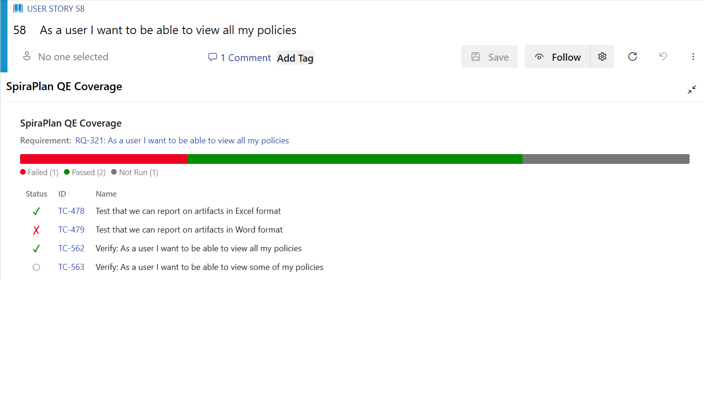
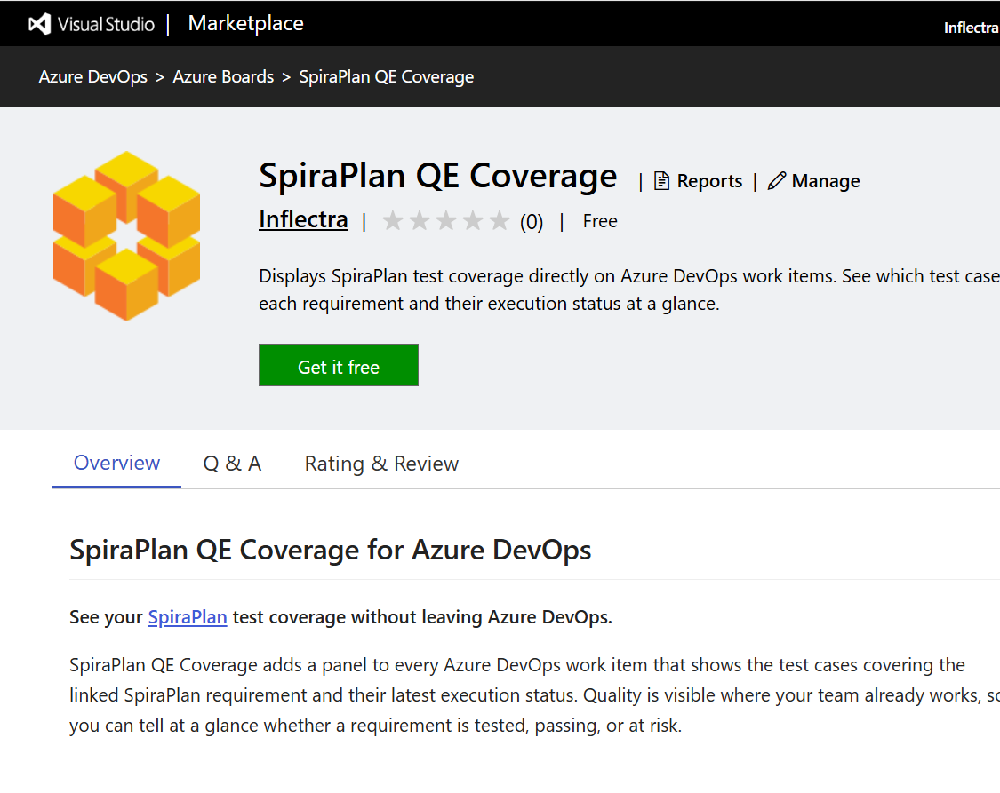
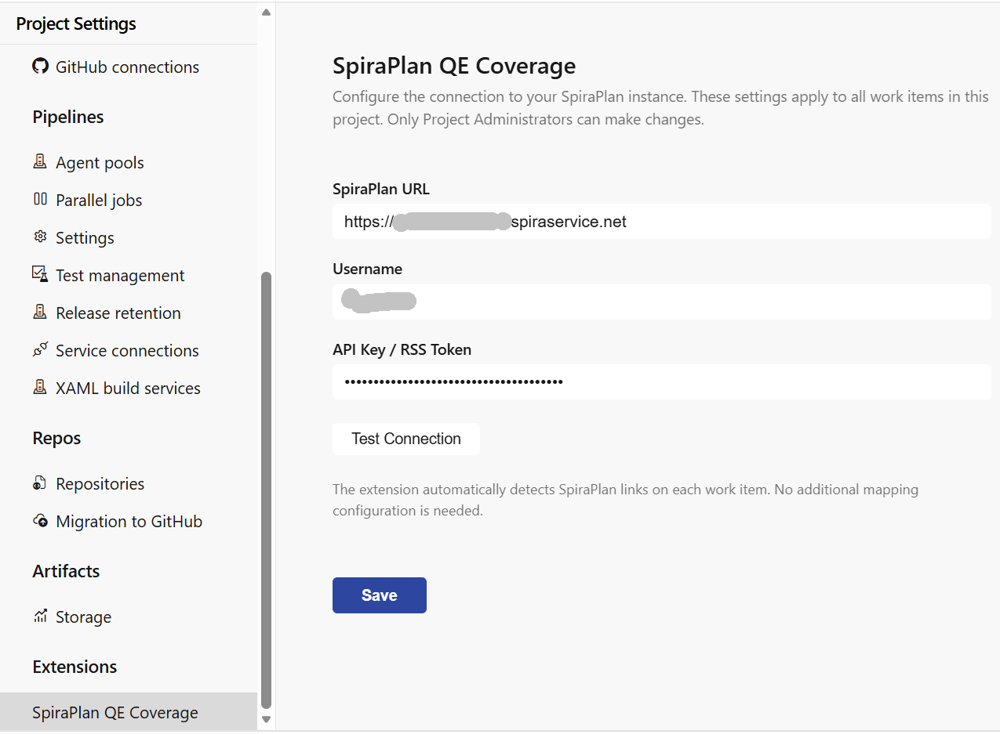
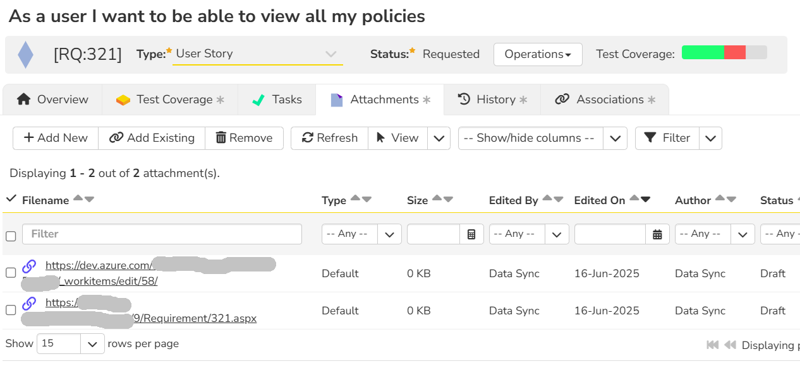
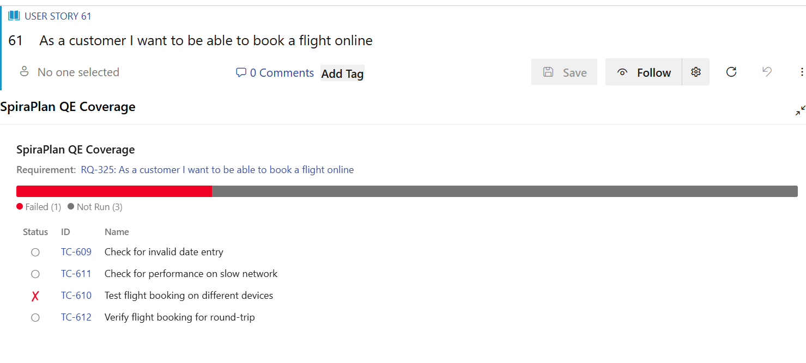

# Microsoft AzureDevOps QE Coverage Extension
!!! abstract "Compatible with SpiraTest, SpiraTeam, SpiraPlan"

!!! info "Install the Azure DevOps (ADO) QE Coverage App"
    This app is available for ADO on the [Visual Studio Marketplace](https://marketplace.visualstudio.com/items?itemName=EvilDauphin.spira-qe-coverage)

The SpiraPlan Quality Engineering (QE) Coverage extension adds a panel to every Azure DevOps work item that shows the
test cases covering the linked SpiraPlan requirement and their latest execution status.

This ensures that the quality of a user story, epic or feature is visible where your team already works (in ADO), so you can tell at a glance whether a requirement is tested, passing, or at risk.

## Why use it

- **Quality in context** — Developers and product owners see test coverage on the
  work item itself, without switching tools or hunting through reports.
- **Zero manual mapping** — The panel reads the SpiraPlan hyperlinks that the
  SpiraPlan–Azure DevOps synchronization already adds to your work items. There is
  nothing to tag or configure per work item.
- **At-a-glance health** — A color-coded status bar summarizes execution results so
  you can spot untested or failing requirements immediately.

## Features

- **Per-work-item coverage panel** — View the test cases that cover the SpiraPlan
  requirement linked to each work item, directly on the work item form.
- **Execution status bar** — A proportional, color-coded breakdown of test
  statuses: Passed, Failed, Not Run, Blocked, Caution, and N/A.
- **Linked test case list** — Every covering test case with its status, ID, and
  name. Select any test case or the requirement to open it in SpiraPlan.
- **Automatic link detection** — Reads the SpiraPlan hyperlinks created by the
  SpiraPlan–Azure DevOps sync. No manual tagging or per-item mapping required.
- **Centralized configuration** — A Project Administrator sets the SpiraPlan
  connection once; the configuration is shared across the organization.

## How it works

1. The extension adds a **SpiraPlan QE Coverage** group to the Azure DevOps work
   item form.
2. When a work item opens, the panel scans its hyperlinks for SpiraPlan URLs.
3. When it finds a linked SpiraPlan requirement, it calls the SpiraPlan REST API
   to retrieve the covering test cases and their execution status.
4. Results appear as a status bar and a detailed, clickable test case list.

## Getting started

1. **Install** the extension into your Azure DevOps organization.

  

2. As a **Project Administrator**, open **Project Settings → SpiraPlan QE Coverage**
   and enter your SpiraPlan connection details (URL, username, API key / RSS token).
   Use **Test Connection** to confirm the credentials, then **Save**.

  

3. Make sure the [SpiraPlan–Azure DevOps synchronization](https://spiradoc.inflectra.com/External-Bug-Tracking-Integration/Using-SpiraTest-with-MS-TFS/) is running — the
   extension relies on the hyperlinks it adds to work items.

4. Open any synchronized work item and expand the **SpiraPlan QE Coverage** group.

> Only Project Administrators can change the connection settings. Other users see
> the coverage panel in read-only form, and are prompted to contact an
> administrator if the connection has not been configured yet.

## Requirements

- **SpiraPlan v6.0 or later** with the REST API enabled.
- The **SpiraPlan–Azure DevOps synchronization** configured (it creates the work
  item hyperlinks the extension reads).
- A SpiraPlan service account with an **API key / RSS token**.

## Privacy and data

The extension communicates only between your Azure DevOps organization and the
SpiraPlan instance you configure. It does not send your data to any third party.
Connection settings are stored in Azure DevOps extension data storage.

## Support

- Product information: [SpiraPlan](https://www.inflectra.com/SpiraPlan/)
- Help and documentation: [Inflectra Support](https://www.inflectra.com/Support/)
