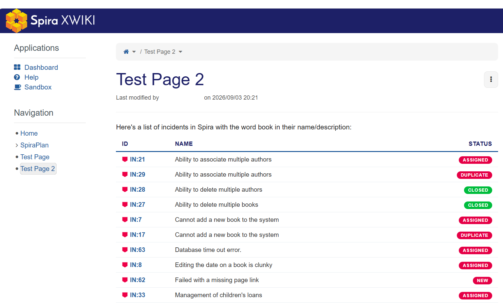
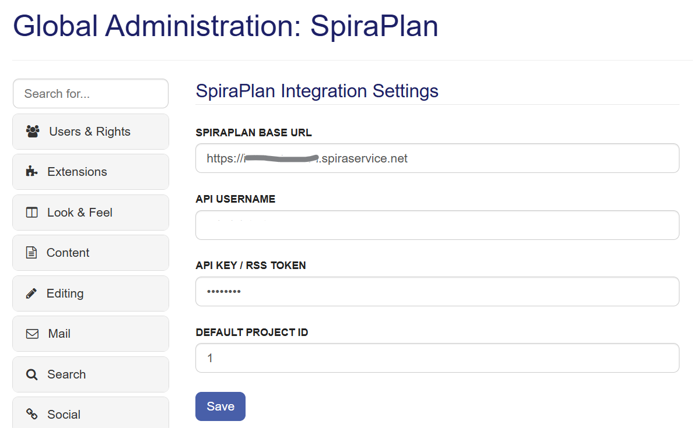
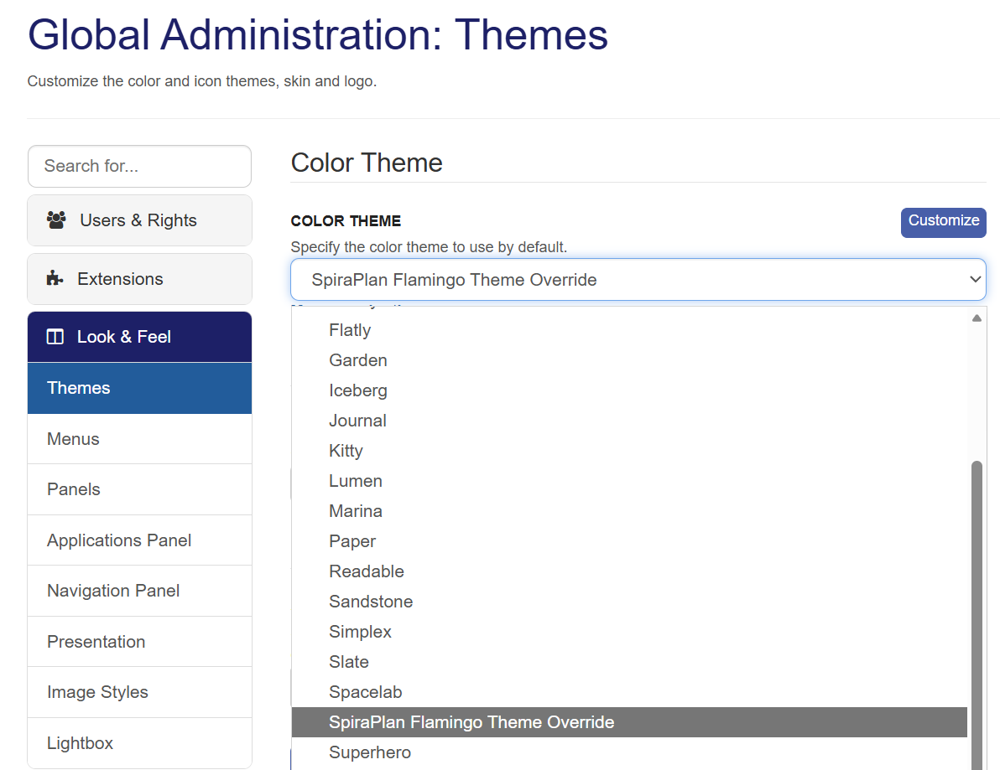
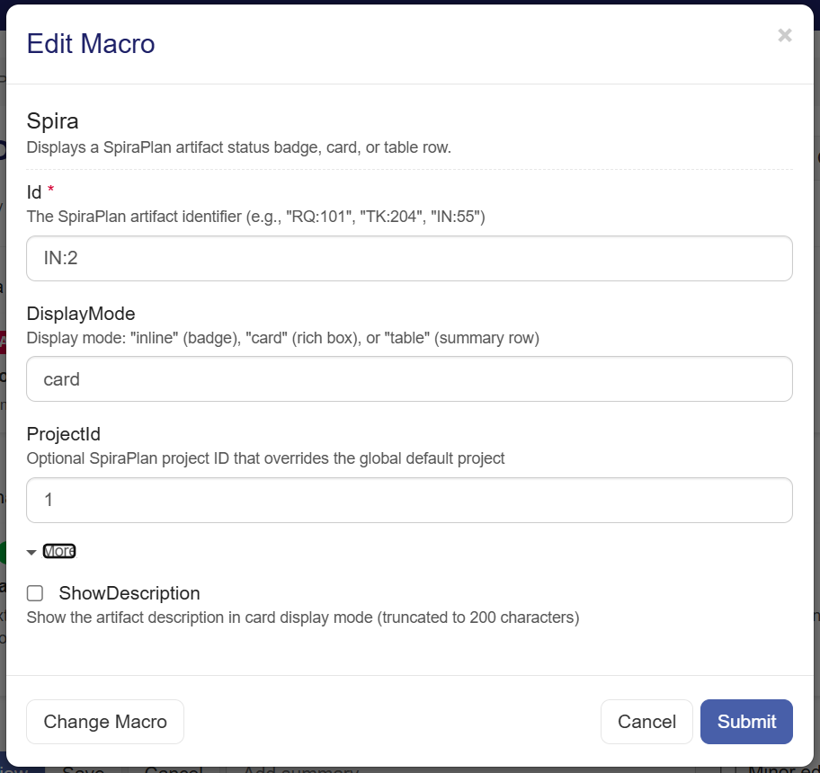
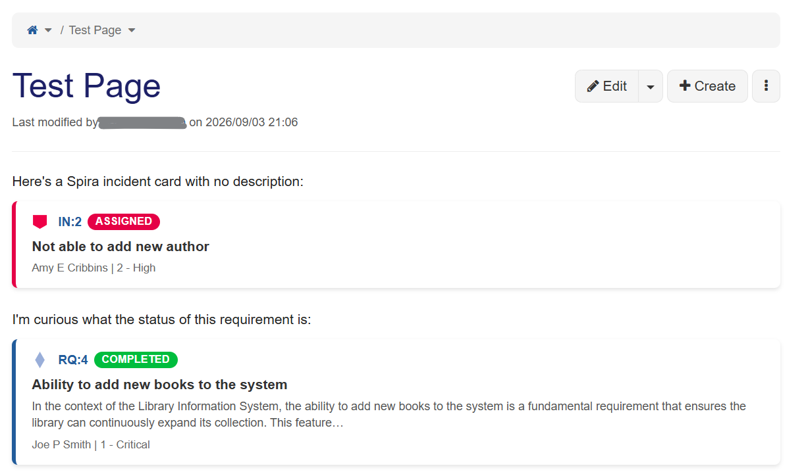
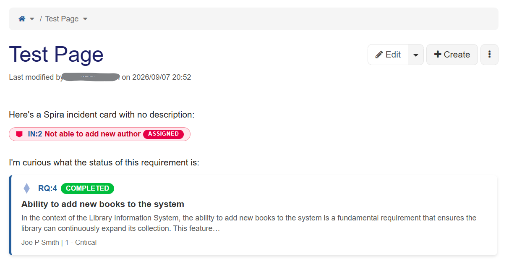
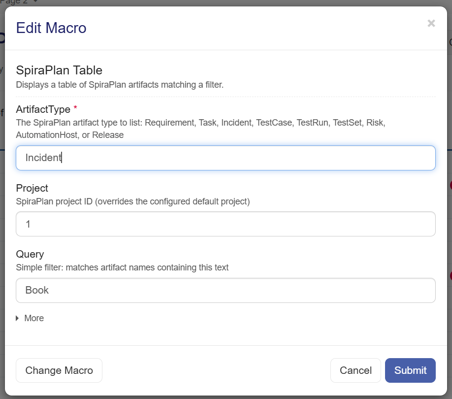
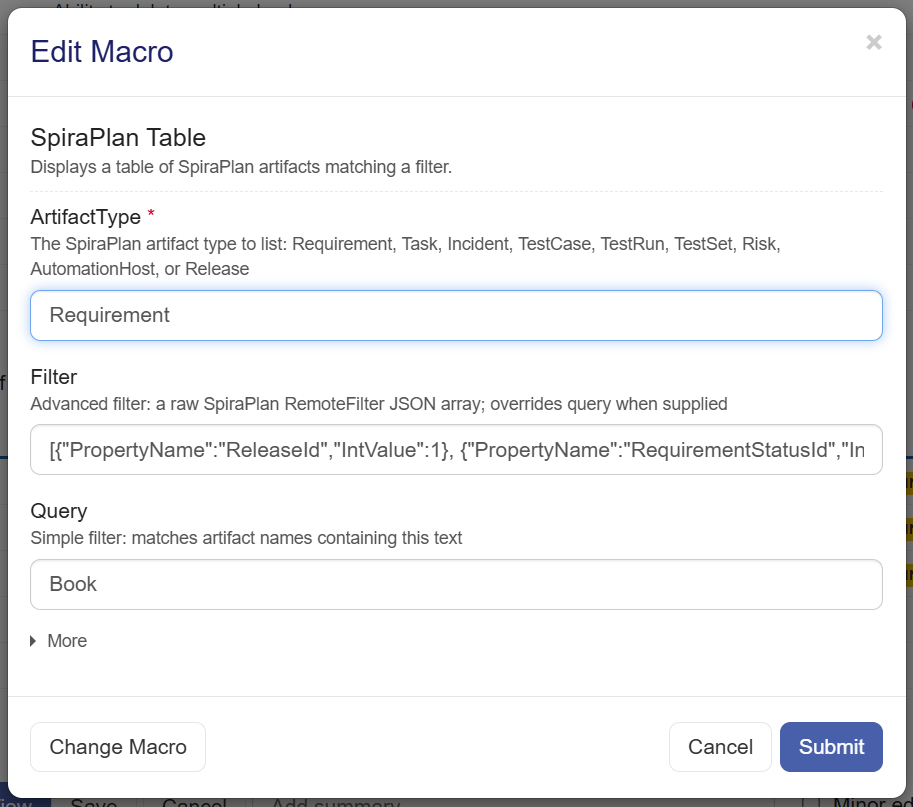
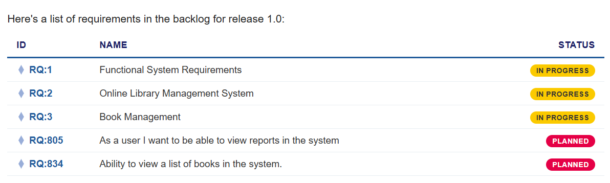

# Using Spira with XWiki
!!! abstract "Compatible with SpiraTest, SpiraTeam, SpiraPlan"

!!! info This guide was written for the Spira Extension for XWiki (beta), running on
    XWiki 18.7 and connected to Spira. Screens and field names may differ
    slightly in other versions. The page uses the term 'Spira' generically
    to refer to any of the editions of the Spira platform.

XWiki is a powerful, open-source enterprise wiki platform. It serves as a modern knowledge management system and application platform designed for teams and organizations that need more than just static documentation. Our Spira Extension for XWiki seamlessly connects live requirements, test coverage, release milestones, and defect tracking directly into the
XWwiki knowledge base.



This documentation describes how to integrate Spira with XWiki and also provides a tutorial on how to enable the special Spira theme and use the special Spira macros in your XWiki pages.

## Overview

This extension for the popular XWiki provides two special macros for embedding
live Spira artifact cards and artifact tables into XWiki pages. In addition,
the extension includes a special, optional Spira theme that can be used to
give the wiki brand consistency with Spira.

In practice, that means you place a small instruction (a *macro*) on a page, and
the extension fetches the current data from Spira every time the page is
viewed — no copying and pasting of status updates.

The extension provides two macros:

- **The Spira macro** displays a single artifact — a requirement, incident, task,
  and so on — as a card, an inline badge, or a table row.
- **The Spira Table macro** displays a list of artifacts that match a query or a
  filter, such as a release backlog or a list of open incidents.

This guide walks you through setting up the extension and using its macros, with
examples drawn from the **Library Information System (LIS)** sample product. It
covers installing and configuring the extension, embedding single artifacts with
the Spira macro, building artifact tables with the Spira Table macro, and using
advanced filters for views such as a release backlog or a list of open incidents.

---

## Contents

- [Background](#background)
- [What Is XWiki?](#what-is-xwiki)
- [Extension Features Overview](#extension-features-overview)
- [Preparing Your Account](#preparing-your-account)
- [Installing the Extension](#installing-the-extension)
- [Configuring the Spira Connection](#configuring-the-spira-connection)
- [Applying the Spira Theme](#applying-the-spira-theme)
- [Understanding Pages and Macros](#understanding-pages-and-macros)
- [Using the Spira Macro](#using-the-spira-macro)
- [Using the Spira Table Macro](#using-the-spira-table-macro)
- [Advanced Table Filters](#advanced-table-filters)
- [Example Pages](#example-pages)

---

## Background

Many teams adopt the combination of XWiki and Spira as an open-source
alternative to proprietary documentation platforms such as Atlassian Confluence.
The pairing connects structured quality-assurance data with collaborative
technical writing: live requirements, test coverage, release milestones, and
defect tracking appear directly inside the knowledge base.

By bringing real-time Spira views — from single-item inline badges to
query-driven backlog tables — into customizable XWiki pages, engineering and
product teams can keep a single source of truth without double entry, constant
context-switching, or third-party marketplace add-ons. The result is live,
two-way traceability between development artifacts and the documentation that
describes them.

---

## What Is XWiki?

XWiki is an open-source enterprise wiki platform built on Java. It works
out-of-the-box as a collaborative wiki, and its architecture also lets teams build
structured web applications, manage content hierarchies, and extend functionality
with inline scripts and custom macros (such as the Spira macros in this guide).
Capabilities relevant to this guide include:

- **Dual editing modes** — a rich WYSIWYG editor and a full source editor.
- **Granular access control** — rights at the wiki, space, page, and field level.
- **Scripting and extensibility** — custom macros and applications, including the
  Spira macros used here.
- **Enterprise features** — SSO, PDF and Office export, versioned history, and
  full-text search.

> **Moving from Confluence?** XWiki provides a dedicated Confluence Migrator (open
> source and XWiki Pro) for transitioning spaces from Confluence Cloud, Server, or
> Data Center. Migration is outside the scope of this guide.

---

## Extension Features Overview

The Spira Extension for XWiki provides two main features:

- **Embedded Spira macros.** Two macros let you embed Spira content in a page:
  one for an individual artifact (the **Spira** macro) and one for a table of
  artifacts matching a query or filter (the **Spira Table** macro).
- **Spira theme and skin.** An optional theme changes the color scheme and
  navigation bar to match Spira. The theme is entirely optional — the macros
  work with any standard or custom XWiki theme.

To use these features you first install the extension, then configure it so it
knows how to connect to your instance of Spira or SpiraTeam. After that, you
can optionally apply the Spira theme, and then begin embedding artifacts with
the `spira` and `spiraTable` macros. The rest of this guide follows exactly that
order.

---

## Preparing Your Account

Two XWiki account preferences control your editing experience across the wiki,
independent of the Spira extension. Set them before you begin so pages open in the
visual editor and the full set of editing tools is available.

1. Select your avatar in the top-right corner and choose **Profile**.
2. In the **Settings** menu, select **Preferences**, then select **Edit**.
3. Under **Editor Preferences**, change both settings:

   | Setting | Set to | Why |
   |---|---|---|
   | **Default editor to use** | **WYSIWYG** | The **Edit** button then opens the rich visual editor (with a formatting toolbar and a **Source** button) instead of the plain text editor. |
   | **User Type** | **Advanced** | A *Simple* user sees a reduced interface and does not get the Spira macros in the editor's insert menu. *Advanced* enables both. |

4. Select **Save**.

---

## Installing the Extension

The Spira extension comes in two parts, and both must be present before the
macros will work:

- the **macro component** (a JAR), which provides the `spira` and `spiraTable`
  macros and the connection to Spira; and
- the **UI pages** (a XAR), which provide the configuration screen and the
  optional Spira theme.

The two parts are installed separately: the UI pages are imported through XWiki's
Import screen, and the macro component is added to the server's library folder.

### Unpack the download

The extension is distributed as a single compressed file (a `.zip`). Extract it
first; inside you will find the two components this guide installs:

- `xwiki-spiraplan-ui-1.0-SNAPSHOT.xar` — the UI pages
- `xwiki-spiraplan-macro-1.0-SNAPSHOT.jar` — the macro component

### Install the UI pages (XAR)

1. Open **Administration → Content → Import**.
2. Select **Upload**, choose the extension's `.xar` file (for example
   `xwiki-spiraplan-ui-1.0-SNAPSHOT.xar`), and upload it.
3. In the **Available Packages** list, select the uploaded package, then select
   **Import**.
4. If prompted about a conflict on `XWiki.XWikiPreferences`, choose to keep the
   merged version and enable **resolve automatically**, then continue.

### Install the macro component (JAR)

The macro component is a Java library and must be placed on the XWiki server's
classpath, then loaded by restarting XWiki.

1. Copy the extension's `.jar` file (for example
   `xwiki-spiraplan-macro-1.0-SNAPSHOT.jar`) into the XWiki web application's
   library folder: `.../webapps/ROOT/WEB-INF/lib/`.
   - In a Docker-based install, place the JAR on a mounted path so it survives
     container restarts, then copy or mount it into
     `/usr/local/tomcat/webapps/ROOT/WEB-INF/lib/` inside the container.
2. Restart XWiki (restart the servlet container, or the `web` container in
   Docker) so the new component is loaded.

With both parts in place, continue to
[Configuring the Spira Connection](#configuring-the-spira-connection).

---

## Configuring the Spira Connection

The extension connects to a single Spira instance and default product,
configured once in the administration settings.



1. Open **Administration**: select your avatar in the top-right corner and choose
   **Administration**.
2. In the navigation menu, under the **Other** category, select **SpiraPlan**.
3. Complete the four fields:

   | Field | What to enter |
   |---|---|
   | **SpiraPlan Base URL** | The base URL of your Spira instance, with no trailing path — for example `https://yourname.spiraservice.net`. |
   | **API Username** | The Spira login name the extension will connect as. |
   | **API Key / RSS Token** | The RSS token for that user. In Spira, open your user profile and locate the **RSS Token**. RSS feeds must be enabled in your profile for the token to work. |
   | **Default Project ID** | The numeric ID of the product to use by default. For the LIS sample product this is `1`. |

4. Select **Save**.

---

## Applying the Spira Theme

The extension includes an optional theme that restyles your wiki to match
Spira. The theme is entirely optional; the macros work with any XWiki theme,
and you can apply or remove the theme at any time.



1. Open **Administration → Look & Feel → Themes**.
2. In the **Color Theme** list, select **SpiraPlan**. If it does not appear there,
   check the **Flamingo Theme** list on the same page.
3. Select **Save**.

---

## Understanding Pages and Macros

A little background makes the rest of the guide easier to follow.

### Spaces and pages

XWiki organizes content into **spaces** (similar to folders) that contain
**pages**, and a page can contain child pages of its own.

### The two editors

Each page can be edited in two ways:

- The **WYSIWYG editor** is the rich visual editor you enabled in
  [Preparing Your Account](#preparing-your-account). It shows macros rendered as
  you build, and lets you insert Spira macros through a form.
- The **Wiki (source) editor** shows the underlying page markup, called *XWiki
  Syntax*. It is useful for pasting an example exactly as written.

In the WYSIWYG editor, select the **Source** button on the toolbar to switch
between the two at any time.

### Macros

A **macro** is an instruction placed in a page that produces dynamic content when
the page is viewed. The Spira extension adds two:

| Macro | Purpose |
|---|---|
| `{{spira}}` | Embeds a single Spira artifact as a card, inline badge, or table row. |
| `{{spiraTable}}` | Embeds a table of Spira artifacts matching a query or filter. |

The sections that follow show how to add each macro with the insert menu. You can
also type a macro as text in the source editor; the examples in this guide include
the source form for reference.

---

## Using the Spira Macro

The Spira macro embeds a single Spira artifact — a requirement, incident,
task, test case, and so on — directly in a page. All you need is the artifact's
**ID** and its **project**.

### Add a macro with the wizard

1. In the editor toolbar, select the `insert` button and choose **Other Macros**.
2. In the **Select Macro** window, type `spira` in the filter box, then choose
   **Spira**.

3. Complete the macro form:

   

   - **Id** *(required)* — the artifact to embed, for example `RQ:4`.
   - **DisplayMode** — how the artifact appears:
     - *Card* — a rich box showing the ID, title, status, priority, and owner.
     - *Inline* — a compact badge that sits within a line of text, ideal when
       space is tight.
     - *Table* — a single summary row.
   - **ProjectId** — the Spira project; leave blank to use the default
     project configured for the extension.
   - **ShowDescription** — tick this to include the artifact's description (card
     mode only).
4. Select **Submit**. The artifact renders in the page.

A requirement added as a card, with its description, renders like this:



> **Prefer to type it?** You can enter the macro directly in the source editor
> instead of using the wizard. The card above is:
> ```
> {{spira id="RQ:4" projectId="1" displayMode="card" showDescription="true"/}}
> ```
> and the inline badge version is:
> ```
> {{spira id="RQ:4" projectId="1" displayMode="inline"/}}
> ```



### Parameters

**Id** *(required)* — the artifact ID, including its two-letter prefix (see
below).
**ProjectId** — the project ID; overrides the default project for this macro.
**DisplayMode** — card, inline, or table.
**ShowDescription** — in card mode, shows the artifact description (up to 200
characters).

The artifact ID is a two-letter prefix followed by the number — for example
`RQ:4` or `IN:2`:

| Prefix | Artifact | | Prefix | Artifact |
|:---:|---|---|:---:|---|
| **RQ** | Requirement | | **TR** | Test Run |
| **TK** | Task | | **TX** | Test Set |
| **IN** | Incident | | **RK** | Risk |
| **TC** | Test Case | | **AH** | Automation Host |
| **RL** | Release | | | |

---

## Using the Spira Table Macro

The Spira Table macro embeds a list of Spira artifacts that match a query or
filter — for example, all incidents mentioning "book", or the requirements in a
release backlog.

### Add a table with the wizard

1. In the editor toolbar, select the `insert` button and choose **Other Macros**.
2. In the **Select Macro** window, type `spira` in the filter box, then choose
   **Spira Table**.
3. Complete the macro form:

   

   - **ArtifactType** *(required)* — the kind of artifact to list: Requirement,
     Task, Incident, Test Case, Test Run, Test Set, Risk, Automation Host, or
     Release.
   - **Filter** — an advanced filter for matching specific fields such as a
     release or status (see [Advanced Table Filters](#advanced-table-filters)).
     When supplied, it overrides **Query**.
   - **MaxResults** — the maximum number of rows to display (default 10).
   - **Project** — the Spira project; leave blank to use the default project.
   - **Query** — a simple text filter; lists artifacts whose name contains this
     text.
4. Select **Submit**. The table renders in the page.

A table of incidents renders like this, with ID, name, and status columns:


### Simple and advanced filtering

The two filtering options cover most needs:

- Use **Query** for quick "name contains X" lists — for example, all incidents
  mentioning "book".
- Use **Filter** when you need to match specific fields, such as the requirements
  in a particular release and status. Advanced filters are covered in
  [Advanced Table Filters](#advanced-table-filters).

> **Prefer to type it?** You can enter the macro directly in the source editor.
> A simple search table is:
> ```
> {{spiraTable artifactType="Incident" project="1" query="book"/}}
> ```

---

## Advanced Table Filters

The **Filter** parameter accepts a raw Spira **RemoteFilter** array — the same
structure the Spira REST API uses. This lets you build views such as a release
backlog by combining conditions on specific fields.

### The shape of a condition

A filter is a JSON array `[ ... ]` of condition objects `{ ... }`. Multiple
conditions are combined with logical **AND**. Each condition names a `PropertyName`
(the Spira field) and the value to match — typically an `IntValue` for a numeric
field such as a release, status, or priority:

```
{"PropertyName":"ReleaseId","IntValue":5}
```

### Filter by release and status

This is the release-backlog view: requirements in a release **and** in a given
status. For the LIS sample product, release `1.0` is `ReleaseId` **1** and the
Planned status is `RequirementStatusId` **2**, so the filter is:

```
[{"PropertyName":"ReleaseId","IntValue":1}, {"PropertyName":"RequirementStatusId","IntValue":2}]
```

Paste that into the wizard's **Filter** field, with **ArtifactType** set to
**Requirement**:



The result is the release 1.0 backlog:



For a different product or release, substitute your own `ReleaseId` and
`RequirementStatusId` values.

> **Prefer to type it?** In the source editor the same filter must escape each
> quote as `~"`:
> ```
> {{spiraTable artifactType="Requirement" project="1"
>   filter="[{~"PropertyName~":~"ReleaseId~",~"IntValue~":1}, {~"PropertyName~":~"RequirementStatusId~",~"IntValue~":2}]"/}}
> ```

### Adding more conditions

Add further conditions to the array, separated by commas, to narrow the results.
Each additional condition applies another **AND**. For example, the release filter
above combines two conditions — `ReleaseId` and `RequirementStatusId`. The same
pattern works with other numeric fields exposed by the Spira REST API.

### Tips for building filters

1. **Start from the working example above** and change only the numeric IDs. When
   typing in source, the `~"` escaping stays intact — that is where hand-typed
   filters usually go wrong.
2. **Design the filter in Spira first.** Build the list you want using Spira's own
   column filters, confirm it returns the right rows, then recreate those
   conditions here. This also reveals the exact field names and IDs your instance
   uses.
